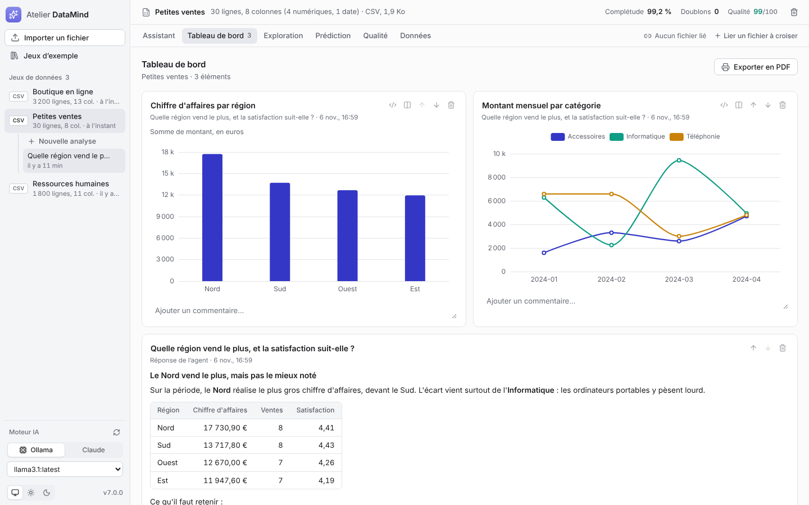
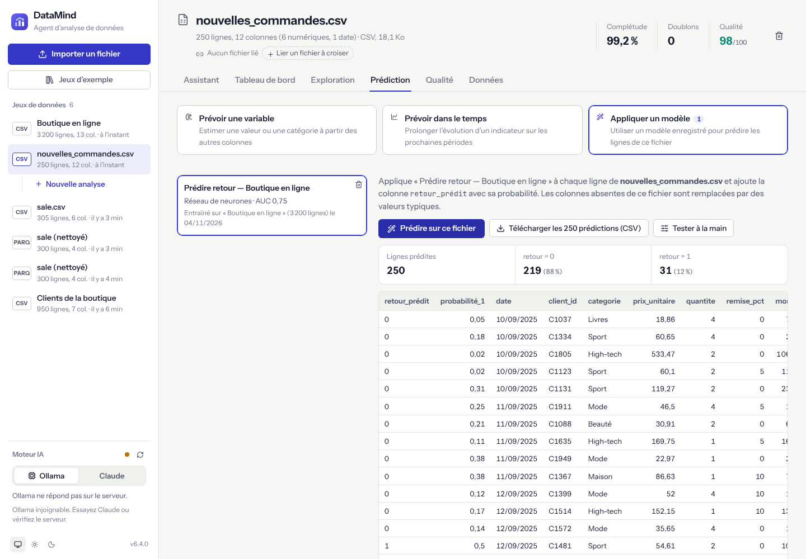

# DataMind

**Agent d'analyse de données.** Importez un fichier, posez vos questions en français :
DataMind écrit des requêtes SQL, les **exécute réellement sur vos données** (DuckDB) et vous répond
avec des chiffres vérifiables, des graphiques et la trace de chaque étape.

Web app TypeScript : backend **Fastify + DuckDB**, frontend **React + Vite**, un seul processus en production.


| Exploration automatique | Qualité des données |
|---|---|
|  |  |

| Tableau de bord | Appliquer un modèle enregistré |
|---|---|
|  |  |

## Fonctionnalités

- **Assistant** — l'agent dispose de cinq outils : `run_sql` (requête en lecture seule sur la table `data`),
  `create_chart` (graphique interactif), `segment` (k-means), `predict` (régression linéaire ou logistique,
  évaluée sur un jeu de test contre une baseline) et `forecast` (tendance + saisonnalité). Chaque étape
  s'affiche dans une trace numérotée : requête SQL (modifiable et relançable), résultat, graphique. 15 analyses en un clic,
  questions de relance après chaque réponse, dictionnaire des colonnes transmis à l'agent.
- **Prédiction** — apprentissage automatique sans code. *Prévoir une variable* : quatre modèles comparés sur un
  jeu de test (référence naïve, régression linéaire ou logistique, gradient boosting d'arbres, réseau de neurones),
  influence des variables et simulateur. *Prévoir dans le temps* : référence naïve, tendance + saisonnalité,
  Holt-Winters et réseau de neurones autorégressif, le meilleur prolonge la série. Fonctionne sans moteur IA.
- **Exploration** — graphiques automatiques (évolution, comparaison, répartition, distribution) et
  exploration colonne par colonne, sans IA.
- **Qualité** — score sur 100, profil de chaque colonne, recommandations de nettoyage.
- **Tableau de bord** — épinglez graphiques, tableaux et réponses ; commentaires, ordre, export PDF.
- **Fichiers liés** — croisez plusieurs fichiers (commandes et clients…) : chaque fichier lié devient une table SQL,
  les clés communes sont détectées et vérifiées.
- **Nettoyage appliqué** — doublons, espaces, nombres en texte, colonnes vides, valeurs manquantes ou atypiques,
  dans une nouvelle version du jeu (l'original est conservé).
- **Modèles enregistrés** — un modèle entraîné se garde et s'applique à un autre fichier (prédictions en CSV).
- **Données** — table paginée côté serveur, recherche, tri, export CSV au format français.
- **Historique** — jeux de données et analyses enregistrés sur le serveur ; export d'une analyse en page HTML.
- **Fichiers** — CSV / TSV (encodage et séparateur détectés, format français `;` et virgule décimale),
  Excel (choix de la feuille), JSON, JSON Lines, Parquet ; jusqu'à 200 Mo.
- **Jeux d'exemple** — 15 jeux fictifs mais réalistes dans 9 domaines (commerce, finance, marketing, IA & tech,
  RH, énergie, santé, immobilier, logistique), accessibles à tout moment depuis la barre latérale, avec des
  questions suggérées pour chacun.
- **Thème** clair, sombre ou celui du système, commun à la suite Atelier (voir « Apparence »).

## Moteurs IA

| Moteur | Coût | Clé | Remarques |
|---|---|---|---|
| **Ollama** (défaut) | Gratuit | Aucune | Le modèle doit gérer les outils : `llama3.1`, `llama3.2`, `qwen2.5`, `mistral-nemo`. |
| **Claude avec ton forfait** | Inclus dans Pro / Max | Aucune : jeton `CLAUDE_CODE_OAUTH_TOKEN` | Via le Claude Agent SDK, pour un usage personnel ; consomme les limites de l'abonnement. |
| **Claude avec une clé API** | À l'usage | `ANTHROPIC_API_KEY` sur le serveur, ou saisie dans l'interface (session) | `claude-sonnet-5-5` par défaut ; Opus 5.5 et Haiku 5.5 au choix. |

**Forfait Claude sans clé API** : sur une machine avec navigateur, lance `claude setup-token` (Claude Code,
connecté à ton compte Pro ou Max), puis renseigne le jeton obtenu dans `CLAUDE_CODE_OAUTH_TOKEN` sur le serveur.
DataMind passe alors par le Claude Agent SDK avec tes outils uniquement (fichiers, commandes et web de Claude Code
désactivés). Cet usage est prévu pour toi seul : n'ouvre pas une instance configurée ainsi à d'autres personnes.

Pour les petits modèles locaux, DataMind rattrape aussi un appel d'outil écrit en JSON dans le texte
et exécute une requête proposée dans un bloc ` ```sql `, puis renvoie le vrai résultat au modèle.

## Démarrage

```bash
git clone https://github.com/m6rdxc9g4t-beep/Agent_Data.git
cd Agent_Data
npm install
npm run dev          # API sur :3600, interface sur http://localhost:5173
```

Production :

```bash
npm run build
STATIC_DIR=frontend/dist npm start      # http://127.0.0.1:3600
```

Docker :

```bash
docker build -t datamind .
docker run -p 3600:3600 -v datamind:/data -e OLLAMA_URL=http://host.docker.internal:11434 datamind
```

### Sur le VPS (suite Atelier)

DataMind est intégré au kit [Atelier_Deploy](https://github.com/m6rdxc9g4t-beep/Atelier_Deploy) :
`https://datamind.<domaine>`, derrière la connexion du portail, avec l'Ollama du serveur.

```bash
cd ~/Ateliers/Atelier_Deploy && sudo ./update.sh datamind
```

## Configuration

Variables d'environnement, toutes facultatives (voir [`.env.example`](.env.example)) :

| Variable | Défaut | Rôle |
|---|---|---|
| `HOST`, `PORT` | `127.0.0.1`, `3600` | Adresse d'écoute |
| `DATA_DIR` | `./data` | Jeux de données (Parquet), analyses, tableaux de bord et modèles enregistrés (JSON) |
| `STATIC_DIR` | — | Interface compilée servie par le backend |
| `MAX_UPLOAD_MB` | `200` | Taille maximale d'un fichier |
| `DATAMIND_ENGINE` | auto | Moteur proposé par défaut (Claude si le forfait est configuré) |
| `OLLAMA_URL` | `http://127.0.0.1:11434` | Serveur Ollama |
| `OLLAMA_MODEL` | `llama3.1` | Modèle Ollama préféré |
| `OLLAMA_TIMEOUT` | `600` | Délai d'une réponse (s) |
| `CLAUDE_CODE_OAUTH_TOKEN` | — | Jeton du forfait Claude (`claude setup-token`), prioritaire sur la clé API |
| `ANTHROPIC_API_KEY` | — | Clé Claude côté serveur |
| `DATAMIND_CLAUDE_MODEL` | `claude-sonnet-5-5` | Modèle Claude par défaut |
| `DATAMIND_MAX_STEPS` | `12` | Allers-retours modèle ↔ outils par question |
| `DATAMIND_QUERY_TIMEOUT` | `60` | Durée maximale d'une requête (s) |
| `DATAMIND_INSTANCE_LABEL` | — | Libellé sous le nom de l'app |

## Architecture

```
backend/src/
├── server.ts          Démarrage
├── app.ts             API REST + réponses de l'agent en flux (SSE), sert l'interface
├── importer.ts        Fichier → Parquet (encodage, séparateur, feuilles Excel)
├── db.ts              DuckDB en mémoire par jeu de données, verrouillé en lecture seule
├── profile.ts         Profil des colonnes, score de qualité, recommandations
├── charts.ts          Graphiques de l'agent et graphiques automatiques
├── analysis.ts        k-means
├── clean.ts           Nettoyage appliqué (nouvelle version du jeu)
├── ml/                Apprentissage : préparation, gradient boosting, réseau de neurones, séries temporelles,
│                      modèles enregistrés (models.ts)
├── store.ts           Métadonnées et analyses en fichiers JSON
└── agent/
    ├── prompts.ts     Prompt système, catalogue des analyses rapides
    ├── tools.ts       Outils de l'agent (schémas + exécution)
    ├── engines.ts     Boucles Claude (clé API) et Ollama
    └── claude-plan.ts Claude avec le forfait (Agent SDK, outils exposés par MCP)
frontend/src/
├── App.tsx            État de l'application, envoi des questions, lecture du flux
├── components/        Barre latérale, marque et « À propos », accueil, Assistant, Exploration, Qualité, Données,
│                      graphiques (ECharts)
├── theme.tsx          Choix du thème (Système / Clair / Sombre) branché sur atelier-theme.js
├── styles.css         Styles de l'app, branchés sur les jetons --atelier-*
└── styles/atelier-brand/  Marque commune de la suite Atelier (copie verbatim, voir « Apparence »)
sample_data/           Jeux d'exemple + catalog.json (titre, domaine, description, questions suggérées)
scripts/
└── generer_exemples.py  Régénère les jeux d'exemple (Python + numpy, graine fixe)
```

**Sécurité des requêtes** : chaque jeu de données est chargé dans une base DuckDB en mémoire, puis l'accès
aux fichiers est coupé (`enable_external_access = false`) et la configuration verrouillée. Seules les
instructions de lecture sont acceptées, une à la fois, avec un délai maximal. Aucun code arbitraire n'est
exécuté. L'app n'a pas de connexion propre : sur un serveur, placez-la derrière une authentification
(c'est le rôle du portail dans la suite Atelier).

## Apparence (suite Atelier)

DataMind suit la charte v2 « Linear » de la suite Atelier (règles : `Atelier_Deploy/DESIGN.md`,
`Atelier_Projets/docs/SUITE.md` §1) : structure commune à la suite, **crème** en clair (`#f8f4ec`) et **bleu nuit**
en sombre (`#0b1220`), police Inter embarquée (13 px), traits de 1 px, aucune ombre au repos. Les cartes de chiffres
(synthèse des prédictions, score de qualité) prennent la forme commune `.atelier-kpi` (coins de 12 px). La couleur signature de DataMind, **indigo `#6967e1`**
(`data-atelier-app="datamind"` sur `<html>`), ne sert qu'à l'accent : bouton principal, sélection, focus, liens
et icône de l'app (carré arrondi en dégradé, glyphe Lucide `sparkles`). La palette des **séries de graphiques**
(`frontend/src/components/Chart.tsx`) et les couleurs du score de qualité ne changent pas (vert et ambre un cran plus
foncés en clair, pour rester lisibles sur la crème).

`frontend/src/styles/atelier-brand/` contient une **copie verbatim** de `Atelier_Projets/design-system/brand/`
(v2) : `atelier-brand.css` (jetons `--atelier-*`, marque, fenêtre « À propos »), `atelier-theme.js` (préférence
de thème commune) et la police Inter (`inter-latin-wght-normal.woff2`, `inter-latin-ext-wght-normal.woff2`,
`LICENSE-Inter.txt`, SIL OFL 1.1). Ne pas modifier ces fichiers ici : les changer dans Atelier_Projets puis les
recopier tels quels. `frontend/vite.config.ts` recopie `atelier-theme.js` en script bloquant en tête de page
(aucun flash) ; la préférence vit dans le cookie `atelier_theme` sur le VPS, partagé avec le portail et les autres
apps, sinon dans `localStorage["atelier:theme"]` (l'ancienne clé `datamind:theme` est reprise une fois).
`frontend/src/styles.css` branche les variables de l'app (`--paper`, `--surface`, `--ink`, `--accent`…) sur ces jetons.

Icônes : `frontend/public/logo.svg` (favicon), `favicon.png` (128 px) et `apple-touch-icon.png` (180 px).

## Développement

```bash
npm run typecheck
npm test             # vitest : import, requêtes, analyses, moteurs simulés, API
```
