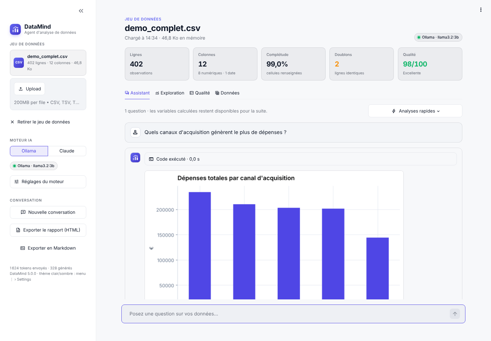
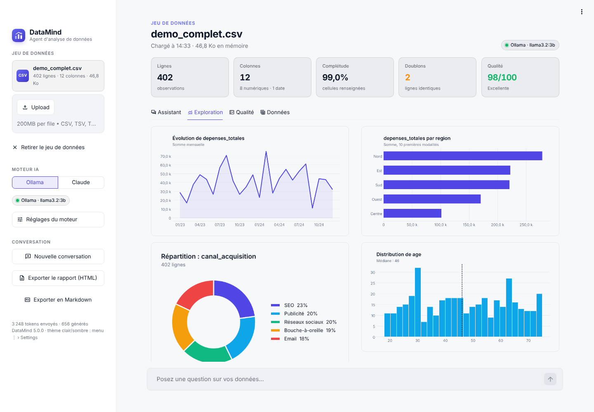
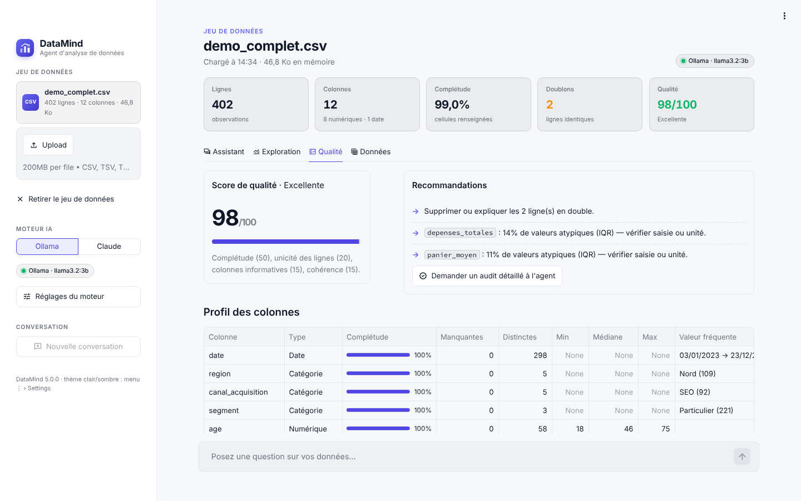

# DataMind

**Agent d'analyse de données.** Importez un fichier, posez vos questions en français :
DataMind écrit du code Python, **l'exécute réellement sur vos données** et vous restitue
des chiffres vérifiables, des graphiques et des recommandations.



| Exploration automatique | Qualité des données |
|---|---|
|  |  |

## Fonctionnalités

- **Assistant** — conversation avec un agent qui calcule au lieu d'inventer : chaque chiffre vient
  de code pandas / scikit-learn exécuté sur `df`. Le code, sa sortie et ses graphiques sont visibles.
  15 analyses en un clic (vue d'ensemble, audit qualité, corrélations, segmentation, tendances,
  prévision, modèle prédictif, facteurs d'influence, tableau de bord…).
- **Exploration** — graphiques automatiques (évolution, comparaison par catégorie, répartition,
  distribution) et exploration colonne par colonne, sans IA, instantanément.
- **Qualité** — score sur 100, profil de chaque colonne (type, complétude, cardinalité, min /
  médiane / max) et recommandations de nettoyage.
- **Données** — table filtrable, export CSV au format français.
- **Rapport** — export de la conversation en HTML autonome (graphiques intégrés) ou en Markdown.
- **Fichiers** — CSV / TSV (encodage et séparateur détectés, format français `;` et `,` décimale),
  Excel (choix de la feuille), JSON, JSON Lines, Parquet ; dates reconnues automatiquement.
- **Thèmes clair et sombre** natifs (menu ⋮ › Settings), interface en français.

## Deux moteurs IA

| Moteur | Coût | Clé | Remarques |
|---|---|---|---|
| **Ollama** (défaut) | Gratuit | Aucune | Modèle local. Doit gérer les outils : `llama3.1`, `llama3.2`, `qwen2.5`, `mistral-nemo`. |
| **Claude** | À l'usage | `ANTHROPIC_API_KEY` | `claude-sonnet-5-5` par défaut ; Opus 5.5 et Haiku 5.5 au choix. |

Les petits modèles locaux n'utilisent pas toujours l'appel d'outil prévu : DataMind exécute aussi
un appel écrit en JSON dans le texte, ou un bloc ```` ```python ```` proposé sans appel, puis renvoie
le résultat réel au modèle pour qu'il l'interprète.

## Démarrage

```bash
git clone https://github.com/m6rdxc9g4t-beep/Agent_Data.git
cd Agent_Data
python -m venv .venv && source .venv/bin/activate
pip install -r requirements.txt

ollama pull llama3.1          # moteur local (https://ollama.com)
streamlit run app.py          # http://localhost:8501
```

Pas de fichier sous la main ? Les jeux **Ventes** et **Clients** (`sample_data/`) se chargent en un clic.

### Avec Docker

```bash
docker build -t datamind .
docker run -p 8501:8501 -e OLLAMA_HOST=http://host.docker.internal:11434 datamind
```

### Sur le VPS (suite Atelier)

DataMind est intégré au kit [Atelier_Deploy](https://github.com/m6rdxc9g4t-beep/Atelier_Deploy) :
`https://datamind.<domaine>`, derrière la connexion du portail, avec l'Ollama du serveur.

```bash
cd ~/Ateliers/Atelier_Deploy && sudo ./update.sh datamind
```

## Configuration

Variables d'environnement (ou fichier `.env`, voir [`.env.example`](.env.example)) — toutes facultatives :

| Variable | Défaut | Rôle |
|---|---|---|
| `DATAMIND_ENGINE` | `ollama` | Moteur affiché au démarrage (`ollama` ou `claude`) |
| `OLLAMA_HOST` (ou `OLLAMA_URL`) | `http://localhost:11434` | Serveur Ollama |
| `OLLAMA_MODEL` | `llama3.1` | Modèle Ollama |
| `OLLAMA_TIMEOUT` | `600` | Délai d'une réponse (s) |
| `ANTHROPIC_API_KEY` | — | Clé Claude côté serveur (sinon saisie dans l'interface, pour la session) |
| `DATAMIND_CLAUDE_MODEL` | `claude-sonnet-5-5` | Modèle Claude |
| `DATAMIND_MAX_STEPS` | `12` | Allers-retours modèle ↔ code par question |
| `DATAMIND_EXEC_TIMEOUT` | `120` | Durée maximale d'une exécution de code (s) |
| `DATAMIND_INSTANCE_LABEL` | — | Libellé sous le nom de l'app |

## Architecture

```
app.py                  Interface Streamlit (barre latérale, onglets, conversation)
datamind/
├── config.py           Réglages (environnement, .env)
├── loader.py           Lecture des fichiers → DataFrame (encodage, séparateur, dates, feuilles)
├── executor.py         Outil run_python : exécution, capture des figures, délai maximal
├── prompts.py          Prompt système + catalogue des 15 analyses rapides
├── profiling.py        Types de colonnes, score de qualité, recommandations
├── charts.py           Graphiques automatiques (clair / sombre)
├── report.py           Export HTML / Markdown
├── theme.py            Couleurs des graphiques
└── engines/
    ├── base.py         Interface commune des moteurs
    ├── claude.py       API Anthropic (cache du prompt, réflexion adaptative)
    └── ollama.py       Ollama local (+ replis pour petits modèles)
assets/                 Logo, styles
sample_data/            Jeux d'exemple
tests/                  pytest (moteurs simulés, aucun appel réseau)
```

Boucle de l'agent : le modèle reçoit le prompt système, un résumé du jeu de données et l'outil
`run_python` ; il écrit du code, DataMind l'exécute dans un espace de noms persistant (`df`,
`df_original`, `pd`, `np`, `plt`, `sns`) et renvoie sortie et erreurs, jusqu'à la réponse finale.

## Développement

```bash
pip install -r requirements-dev.txt
ruff check . && pytest
```

## Sécurité

Comme un notebook, l'outil `run_python` exécute du code arbitraire dans le processus de l'app.
DataMind est fait pour analyser **vos** données : sur un serveur, faites-le tourner dans un
conteneur (image fournie, utilisateur sans privilèges) et derrière une authentification —
c'est le cas dans la suite Atelier, où le portail protège `datamind.<domaine>`.
